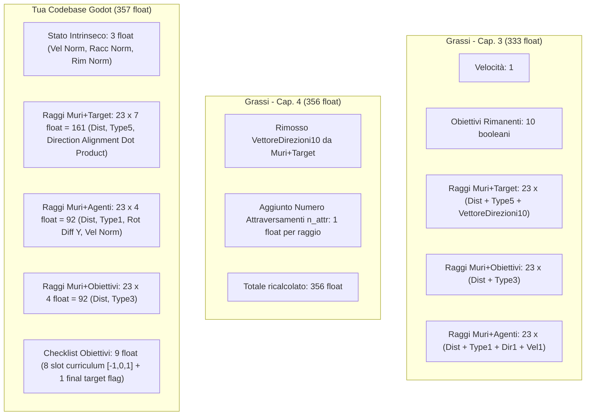

# Analisi Comparativa: Relazione di Stage Grassi (Unity) vs Codebase Godot

Documento di confronto tecnico puntuale e approfondito tra la relazione di stage del collega **Grassi** ([`Relazione_stage_Grassi-36-57.pdf`](file:///home/gigi/Documenti/Relazione_stage_Grassi-36-57.pdf), Capitoli 3 e 4) sviluppata in **Unity con ML-Agents** e la presente codebase del progetto [**RL-Godot-Pedestrian-Simulation**](file:///home/gigi/Documenti/RL-Godot-Pedestrian-Simulation) realizzata con **Godot 4.2 .NET, Stable-Baselines3 (SB3) e PedPy**.

---

## 1. Quadro Generale e Stack Architetturale

La relazione del collega Grassi e la presente codebase condividono l'obiettivo scientifico di base (simulazione pedonale autonoma tramite *Deep Reinforcement Learning* e *Curriculum Learning* con raccolta di obiettivi sequenziali). Tuttavia, le scelte architetturali, i motori software e le metodologie di addestramento e validazione divergono radicalmente.

| Dimensione | Progetto Collega Grassi ([`Relazione_stage_Grassi-36-57.pdf`](file:///home/gigi/Documenti/Relazione_stage_Grassi-36-57.pdf)) | Tua Codebase ([`RL-Godot-Pedestrian-Simulation`](file:///home/gigi/Documenti/RL-Godot-Pedestrian-Simulation)) |
| :--- | :--- | :--- |
| **Engine di Simulazione** | **Unity 3D** (proprietario, C#) | **Godot Engine 4.2 .NET** (open source, C# + GDScript, Vulkan/Forward+) |
| **Framework RL** | **Unity ML-Agents Toolkit** (trainer interno `mlagents-learn` con backend PyTorch) | **Godot-RL-Agents** + **Stable-Baselines3** (`PPO`, `VecMonitor`, PyTorch nativo) |
| **Protocollo di Comunicazione** | Canale proprietario IPC / gRPC di ML-Agents | Socket TCP aperta ([`StreamPeerTCP`](file:///home/gigi/Documenti/RL-Godot-Pedestrian-Simulation/godot/utils/Sync.gd#L21)) su porta `11008` con scambio di stringhe JSON |
| **Pipeline di Addestramento** | Gestita dall'eseguibile CLI di ML-Agents con checkpoint automatici | Gestita da script Python proprietario ([`Runner.py`](file:///home/gigi/Documenti/RL-Godot-Pedestrian-Simulation/scripts/utils/Runner.py)) con caricamento/salvataggio dei pesi `.zip` ad ogni passaggio di livello del curriculum |
| **Early Stopping & Validazione** | Media mobile semplice di reward per ambiente gestita da ML-Agents | Callback combinato proprietario ([`EndTrainingCombinedCallback`](file:///home/gigi/Documenti/RL-Godot-Pedestrian-Simulation/scripts/utils/Callbacks.py#L94)) con **media troncata al 10%** (`trimmed_mean`) per eliminare outlier stocastici |
| **Validazione & Analisi Scientifica** | Valutazione qualitativa su singola scena e grafici TensorBoard standard | **PedPy**: campionamento frame-by-frame delle coordinate in file `.txt` e analisi quantitativa (diagramma fondamentale di Weidmann, densità di Voronoi, profili di velocità) |
| **Deployment del Modello** | Unity Barracuda / Sentis interno | Esportazione in formato aperto ONNX ([`export_model_as_onnx`](file:///home/gigi/Documenti/RL-Godot-Pedestrian-Simulation/scripts/utils/Runner.py#L316)) ed esecuzione nativa in Godot tramite [Microsoft.ML.OnnxRuntime](file:///home/gigi/Documenti/RL-Godot-Pedestrian-Simulation/godot/RL-Godot-Pedestrian-Simulation.csproj#L10) |

---

## 2. Spazio delle Osservazioni (Observation Space)

Grassi descrive due iterazioni consecutive del modello:
1. **Capitolo 3 ("Modello per la pianificazione di percorsi")**: modello deterministico con **333 float**. Ogni target intermedio proietta un vettore booleano di 10 elementi indicante esplicitamente quali obiettivi sono raggiungibili oltre il varco.
2. **Capitolo 4 ("Modello per l'esplorazione di ambienti strutturati")**: modello con incertezza da **356 float**. Rimuove la guida deterministica e aggiunge ai raggi il conteggio degli attraversamenti effettuati ($n_{\text{attr}}$).

La tua codebase implementa invece un'architettura da **357 float** basata su allineamento vettoriale (*direction alignment*) e checklist ad accesso diretto.



### Dettaglio delle Differenze nelle Osservazioni

| Elemento Percettivo | Grassi (Relazione Unity) | Tua Codebase (Godot) | Rilevanza Funzionale |
| :--- | :--- | :--- | :--- |
| **Normalizzazione Distanze** | Distanza reale divisa per **$43.0\text{ m}$** (diagonale massima dell'ambiente $30 \times 30$, Eq. 3.3) | Distanza reale divisa per **$10.0\text{ m}$** ([`RAY_LENGTH_OBS`](file:///home/gigi/Documenti/RL-Godot-Pedestrian-Simulation/godot/utils/constants.gd#L50)) | La normalizzazione di Grassi copre l'intero ambiente; la tua codebase satura a 1.0 oltre i 10 metri, privilegiando la percezione locale del pedone. |
| **Stato Obiettivi Intrinseco** | Vettore booleano di lunghezza fissa 10: `[1, 0, 0, 1, 0, 1, 0, 0, 0, 0]` (9 obiettivi + 1 target finale) | Due scalari normalizzati in $[0, 1]$ ([`AIController3D.gd#L97`](file:///home/gigi/Documenti/RL-Godot-Pedestrian-Simulation/godot/objects/pedestrian/AIController3D.gd#L97)): `objectives_collected_norm` e `objectives_remaining_norm` | La rappresentazione frazionaria continua in Godot aiuta la rete a stimare il progresso senza dover contare i bit attivi. |
| **Percezione Target Intermedi** | **Cap. 3**: Vettore booleano di 10 elementi per ogni raggio indicante gli obiettivi a valle.<br>**Cap. 4**: Numero di attraversamenti già effettuati ($n_{\text{attr}}$ per raggio: $n \ge 0$ se target, $-1$ altrimenti). | **Direction Alignment** scalare in $[-1, +1]$ ([`RayCastSensor3D.gd#L426`](file:///home/gigi/Documenti/RL-Godot-Pedestrian-Simulation/godot/objects/pedestrian/RayCastSensor3D.gd#L426)): dot product tra direzione del raggio e normale forward del target. | Grassi usa il target come bacheca informativa o contatore di loop; Godot usa il target come porta direzionale (distingue fronte, lato e retro). |
| **Checklist ID Obiettivi** | Non presente. L'agente non sa l'indice specifico di ciascun obiettivo raccolto. | Presente in [`pedestrian.gd#L376`](file:///home/gigi/Documenti/RL-Godot-Pedestrian-Simulation/godot/objects/pedestrian/pedestrian.gd#L376): array di 8 slot con padding `-1` se l'obiettivo non esiste nel livello, `0` se da fare, `1` se raccolto. | In Godot la rete ha memoria esplicita di quali checkpoint mancano all'appello. |
| **Conteggio Float Totali** | **333 float** (Cap. 3) / **356 float** (Cap. 4) | **357 float** (il commento in `AIController3D.gd#L65` riportava 359 per refuso storico con `MAX_OBJECTIVES = 10`) | Il vettore Godot è compatto e costante in tutte le fasi di training. |

---

## 3. Modello di Reward a Confronto

Il modello delle ricompense condivide la penalizzazione delle collisioni e la tutela degli spazi prossemici di Edward T. Hall, ma differisce fortemente nell'intensità delle penalità continue e nella gestione dei loop.

### Tabella Comparativa Formule di Reward

| Azione / Stato | Formula Grassi (Unity - Eq. 3.6 / 4.2) | Valore Codebase Godot ([`constants.gd`](file:///home/gigi/Documenti/RL-Godot-Pedestrian-Simulation/godot/utils/constants.gd)) | Analisi Tecnica delle Differenze |
| :--- | :---: | :---: | :--- |
| **Target Finale con tutti gli obiettivi** | `+8.0` | `+8.0` ([`FINAL_TARGET_REW`](file:///home/gigi/Documenti/RL-Godot-Pedestrian-Simulation/godot/utils/constants.gd#L22)) | Identico reward positivo terminale. |
| **Target Finale con obiettivi mancanti** | `-4.0` *(nel testo di 3.4.1 indicato come -3)* | `-4.0` ([`FINAL_TARGET_WITHOUT_OBJECTIVES_REW`](file:///home/gigi/Documenti/RL-Godot-Pedestrian-Simulation/godot/utils/constants.gd#L23)) | Identica penalità per uscita prematura. |
| **Attraversamento Target non valido** | **`-1.5`** | **`-2.0`** ([`INTERMEDIATE_TARGET_MALUS_REW`](file:///home/gigi/Documenti/RL-Godot-Pedestrian-Simulation/godot/utils/constants.gd#L30)) | Godot penalizza più severamente l'imbocco del varco errato. |
| **Attraversamento Target valido** | `0.0` | `0.0` ([`INTERMEDIATE_TARGET_BONUS_REW`](file:///home/gigi/Documenti/RL-Godot-Pedestrian-Simulation/godot/utils/constants.gd#L29)) | Entrambi i progetti non danno reward positiva al varco corretto. |
| **Attraversamento Ripetuto dello stesso Target** | **$-0.03 \cdot n_{\text{attr}}$** *(Cap. 4: penalità progressiva)* | `0.0` ([`INTERMEDIATE_TARGET_ALREADY_REACHED_REW`](file:///home/gigi/Documenti/RL-Godot-Pedestrian-Simulation/godot/utils/constants.gd#L26)) | **Grassi ha una penalità anti-loop esplicita**. In Godot i riattraversamenti ricevono reward neutra ($0.0$), facilitando oscillazioni a vuoto. |
| **Raccolta Obiettivo** | `+2.0` | `+2.0` ([`OBJECTIVE_COLLECTED_REW`](file:///home/gigi/Documenti/RL-Godot-Pedestrian-Simulation/godot/utils/constants.gd#L32)) | Identico valore. **Trigger diverso**: Grassi assegna il reward **all'uscita** dall'area; Godot lo assegna **all'ingresso** e disattiva il nodo. |
| **Penalità continua Obiettivi Mancanti** | **$-0.06 \cdot n_{\text{rim}}$** ad ogni timestep | **$-0.002 \cdot \frac{n_{\text{rim}}}{n_{\text{tot}}}$** ad ogni timestep | **Discrepanza radicale**: Grassi sottrae fino a $-0.18$ a step per 3 obiettivi. In Godot la penalità è una frazione piccolissima ($-0.002$), 90 volte inferiore. |
| **Collisione Muro (distanza minima)** | `-0.5` (entro **$0.6\text{ m}$**) | `-0.5` (entro **$0.4\text{ m}$**) | Grassi considera collisione entro $60\text{ cm}$; Godot consente al pedone di avvicinarsi fino a $40\text{ cm}$. |
| **Prossemica: Collisione Agente (Intima)** | `-0.5` (entro $0.6\text{ m}$) | `-0.5` (entro $0.6\text{ m}$) | Identico. |
| **Prossemica: Distanza Sociale** | `-0.005` (entro $1.0\text{ m}$) | `-0.005` (entro $1.0\text{ m}$) | Identico. |
| **Prossemica: Distanza Pubblica** | `-0.001` (entro $1.4\text{ m}$) | `-0.001` (entro $1.4\text{ m}$) | Identico. |
| **Timestep Penalty** | `-0.0001` | `-0.0001` | Identico. |
| **Timeout Episodio** | `-6.0` | `-6.0` | Identico. |

---

## 4. Curriculum Learning e Ambienti

### 4.1 La Struttura dei Livelli

Grassi definisce un curriculum a 17 ambienti (Tabelle 3.2 e 4.2), pensati per introdurre progressivamente complessità semantiche:

```
Curriculum Grassi (Unity):
StartDynamic -> CorridorObjectiveSmall -> StartObjectiveRandom -> StartIntermediateTarget ->
Corridor1vs1 -> PassageOpposite -> TakeObjectiveAndPass -> EasyChoice -> DoubleChoice+ ->
TaskBeforeExit -> TwoRooms -> Rooms -> FindObjective -> LibrarySmall -> Rows -> ChooseDoors -> House
```

#### Corrispondenza Inaspettata nella Tua Codebase:
Nella tua cartella [`godot/environments/levels/training/`](file:///home/gigi/Documenti/RL-Godot-Pedestrian-Simulation/godot/environments/levels/training/) **esistono esattamente tutte le scene corrispondenti al curriculum di Grassi**:
- [`TakeObjectiveAndPass.tscn`](file:///home/gigi/Documenti/RL-Godot-Pedestrian-Simulation/godot/environments/levels/training/TakeObjectiveAndPass.tscn)
- [`EasyChoice.tscn`](file:///home/gigi/Documenti/RL-Godot-Pedestrian-Simulation/godot/environments/levels/training/EasyChoice.tscn)
- [`DoubleChoice+.tscn`](file:///home/gigi/Documenti/RL-Godot-Pedestrian-Simulation/godot/environments/levels/training/DoubleChoice+.tscn)
- [`TaskBeforeExit.tscn`](file:///home/gigi/Documenti/RL-Godot-Pedestrian-Simulation/godot/environments/levels/training/TaskBeforeExit.tscn)
- [`TwoRooms.tscn`](file:///home/gigi/Documenti/RL-Godot-Pedestrian-Simulation/godot/environments/levels/training/TwoRooms.tscn)
- [`Rooms.tscn`](file:///home/gigi/Documenti/RL-Godot-Pedestrian-Simulation/godot/environments/levels/training/Rooms.tscn)
- [`FindObjective.tscn`](file:///home/gigi/Documenti/RL-Godot-Pedestrian-Simulation/godot/environments/levels/training/FindObjective.tscn)
- [`LibrarySmall.tscn`](file:///home/gigi/Documenti/RL-Godot-Pedestrian-Simulation/godot/environments/levels/training/LibrarySmall.tscn)
- [`Rows.tscn`](file:///home/gigi/Documenti/RL-Godot-Pedestrian-Simulation/godot/environments/levels/training/Rows.tscn)
- [`ChooseDoors.tscn`](file:///home/gigi/Documenti/RL-Godot-Pedestrian-Simulation/godot/environments/levels/training/ChooseDoors.tscn)
- [`House.tscn`](file:///home/gigi/Documenti/RL-Godot-Pedestrian-Simulation/godot/environments/levels/training/House.tscn)
- [`Corridor1vs1.tscn`](file:///home/gigi/Documenti/RL-Godot-Pedestrian-Simulation/godot/environments/levels/training/Corridor1vs1.tscn)

**Tuttavia, nella tua configurazione attiva** ([`training_scene.tscn`](file:///home/gigi/Documenti/RL-Godot-Pedestrian-Simulation/godot/training/training_scene.tscn) e [`curriculum_lab2.yaml`](file:///home/gigi/Documenti/RL-Godot-Pedestrian-Simulation/scripts/configs/curriculumObjective/curriculum_lab2.yaml)), **questi ambienti sono stati rimossi dal curriculum** e sostituiti con una sequenza di labirinti geometrici:
`StartEz` $\rightarrow$ `Start` $\rightarrow$ `CorridorObjective` $\rightarrow$ `StartObjectiveRandom` $\rightarrow$ `StartObjectiveRandom2` $\rightarrow$ `CorridorObjtFacile` $\rightarrow$ `CorridorObjtMedio` $\rightarrow$ `CorridorObjt` $\rightarrow$ `Horseshoe` $\rightarrow$ `Blind1` $\rightarrow$ `Blind2` $\rightarrow$ `Labyrinth` $\rightarrow$ `Labyrinth4` $\rightarrow$ `Labyrinth2` $\rightarrow$ `Labyrinth3` $\rightarrow$ `Final`.

### 4.2 Differenze di Soglie di Avanzamento

| Livello Esempio | Soglia Grassi (Tabella 3.2) | Soglia Tua Codebase ([`troppo_bassi_i_valori.yaml`](file:///home/gigi/Documenti/RL-Godot-Pedestrian-Simulation/scripts/configs/curriculumObjective/troppo_bassi_i_valori.yaml)) | Motivazione del Divario |
| :--- | :---: | :---: | :--- |
| **`StartDynamic` / `StartEz`** | `5.5` | `7.0` | In Godot la timestep penalty cumulativa è minore. |
| **`CorridorObjective`** | `4.0` | `9.0` | In Grassi il termine $-0.06 \cdot n_{\text{rim}}$ abbatte la reward cumulativa media. |
| **`StartObjectiveRandom`** | `5.0` | `9.7` | Stessa ragione: penalità per step incompleti molto più severa in Unity. |
| **`TwoRooms` / `Labyrinth`** | `4.5` | `13.5` | I labirinti di Godot contengono più checkpoint (ognuno $+2.0$). |
| **Livello Finale** | `3.0` (`House`) | `17.8` (`Final`) | Scale di punteggio completamente sfasate. |

### 4.3 Modalità di Retraining
- **Grassi**: Flag booleano statico assegnato ad ogni ambiente (Tabella 3.2: 9 ambienti su 17 vengono inclusi nel retraining finale, mentre gli altri 8 vengono scartati).
- **Tua Codebase**: La scena [`retraining_scene.gd`](file:///home/gigi/Documenti/RL-Godot-Pedestrian-Simulation/godot/utils/retraining_scene.gd) genera dinamicamente una matrice parallela con 3 istanze per ciascun livello (`instances_per_level = 3`) disposte a griglia spaziale con offset di 40m. Nelle ultime run di sensitività, tuttavia, `retraining_steps` è stato azzerato per risparmiare tempo di calcolo.

---

## 5. Validazione e Testing a Confronto

| Aspetto di Verifica | Relazione Grassi (Unity) | Tua Codebase (Godot) |
| :--- | :--- | :--- |
| **Scenario di Test** | Singolo ambiente tematico: **`Supermarket`** ([`Relazione_stage_Grassi-36-57.pdf#L614`](file:///home/gigi/Documenti/Relazione_stage_Grassi-36-57.pdf#L614)), con corsie e scaffali in cui simulare una sessione di acquisti con obiettivi casuali. | Suite scientifica completa con **18 scenari di benchmark** ([`godot/environments/levels/testing/`](file:///home/gigi/Documenti/RL-Godot-Pedestrian-Simulation/godot/environments/levels/testing/)): `Bottleneck`, `Funnel`, `DoubleDoor`, `VCross`, `CornerConnection`, `Omega`. |
| **Metriche Estratte** | Tempo di completamento dell'episodio e tracciamento qualitativo delle linee di percorso (Figure 3.13 e 3.14). | **PedPy quantitative**: densità di Voronoi locale/globale, velocità media puntuale, portata (*flow rate* $J$), confronto con le curve empiriche di Weidmann. |
| **Focus della Ricerca** | Valutare se l'agente sa pianificare una traiettoria per raccogliere item sparsi senza bloccarsi. | Valutare se le dinamiche emergenti dell'agente RL replicano fedelmente la fisica reale delle folle e la capacità di attraversamento dei varchi stretti. |

---

## 6. Sintesi dei Punti di Forza e Spunti di Integrazione

### Cosa la tua codebase ha di superiore rispetto al lavoro di Grassi:
1. **Toolchain Scientifica Aperta**: Nessun vincolo proprietario con Unity. Stack integrato Python-first (Stable-Baselines3 + Godot-RL + PedPy) estremamente riproducibile e personalizzabile.
2. **Validazione dei Flussi Realistica**: I test su geometrie di collo di bottiglia e flussi incrociati con PedPy offrono una validazione scientifica incomparabilmente più solida rispetto al solo test qualitativo sul "Supermarket".
3. **Robustezza Statistica dell'Addestramento**: L'uso del `trimmed_mean` al 10% in [`Callbacks.py`](file:///home/gigi/Documenti/RL-Godot-Pedestrian-Simulation/scripts/utils/Callbacks.py#L176) evita transizioni di livello premature provocate da episodi fortunati.

### Cosa puoi importare utilmente dalla relazione di Grassi:
1. **Penalità anti-loop sui varchi (`-0.03 * nattr`)**:
   Implementare la formula (4.2) di Grassi in [`pedestrian.gd`](file:///home/gigi/Documenti/RL-Godot-Pedestrian-Simulation/godot/objects/pedestrian/pedestrian.gd):
   ```gdscript
   # Se il target è già stato attraversato, penalizza proporzionalmente
   var crossing_count = get_target_crossings(last_target_reached)
   tot_reward -= 0.03 * crossing_count
   ```
   Questo eliminerebbe i loop infiniti e le oscillazioni riscontrate in `Blind2` e `Labyrinth`.
2. **Riattivazione degli scenari realistici già pronti**:
   Dato che possiedi già le scene [`House.tscn`](file:///home/gigi/Documenti/RL-Godot-Pedestrian-Simulation/godot/environments/levels/training/House.tscn), [`Rows.tscn`](file:///home/gigi/Documenti/RL-Godot-Pedestrian-Simulation/godot/environments/levels/training/Rows.tscn) e [`ChooseDoors.tscn`](file:///home/gigi/Documenti/RL-Godot-Pedestrian-Simulation/godot/environments/levels/training/ChooseDoors.tscn) modellate in Godot, reintrodurle nel curriculum subito prima del test finale aumenterebbe significativamente la capacità di generalizzazione del modello.
