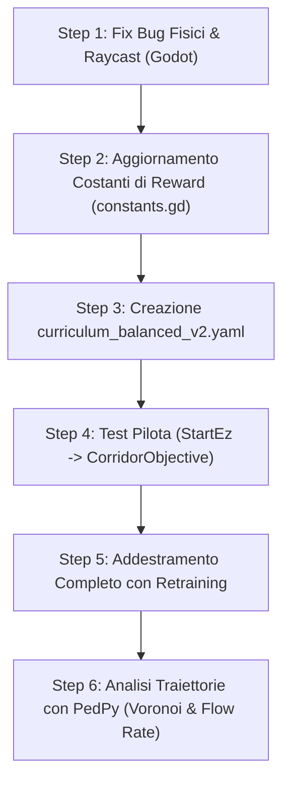

# Piano di Intervento: Fix, Calibrazione Reward e Ottimizzazione Curriculum

Documento strategico ed esecutivo per risolvere i colli di bottiglia emersi durante gli addestramenti del simulatore pedonale (**RL-Godot-Pedestrian-Simulation**).

---

## 1. Bug e Fix Tecnici della Codebase

### 1.1 BUG CRITICO: Calcolo di `viewed_side` per Target Intermedi ([`pedestrian.gd`](../godot/objects/pedestrian/pedestrian.gd#L196))
- **Problema**: L'assegnazione di bonus o malus all'attraversamento di un target intermedio si basa su `get_last_viewed_side(last_target_reached)`. Questo valore viene memorizzato dai raycast durante la marcia ([`RayCastSensor3D.gd`](../godot/objects/pedestrian/RayCastSensor3D.gd#L483)). Se il pedone entra nel target guardando lateralmente, o se retrocede dopo aver visto il retro in precedenza, `viewed_side` risulta errato o `"unknown"`. Nei livelli ciechi come `Blind2` questo genera malus inattesi ($-2.0$) pur avendo raccolto gli obiettivi, spiegando il fallimento registrato nella run `output_bene_maleblind2_da_fixare`.
- **Fix**: Calcolare il vettore geometrico di attraversamento fisico usando la velocità istantanea del pedone rispetto alla normale globale del target al momento del trigger `_on_target_entered`.

```gdscript
# In godot/objects/pedestrian/pedestrian.gd
func _on_target_entered(area, body):
	if body == self:
		target_reached = true
		last_target_reached = area
		
		# Calcolo affidabile del lato fisico di attraversamento
		if area.has_method("get_side_from_vector"):
			# Usa il vettore velocità attuale proiettato sulla normale
			var crossing_dir = velocity.normalized()
			var side = area.get_side_from_vector(crossing_dir)
			set_meta("actual_crossing_side", side)
```

E in [`target.gd`](../godot/objects/targets/target.gd):
```gdscript
func get_side_from_vector(dir: Vector3) -> String:
	var target_forward_global = transform.basis * forward_direction.normalized()
	var dot = dir.dot(target_forward_global)
	if dot > 0.2:
		return "front"
	elif dot < -0.2:
		return "back"
	return "side"
```

---

### 1.2 Disallineamento Spazio Osservazioni (357 vs 359 float) ([`AIController3D.gd`](../godot/objects/pedestrian/AIController3D.gd#L65))
- **Problema**: Il commento nel file indica 359 float, mentre l'algoritmo calcola:
  - 161 (muri/target: $23 \times 7$)
  - 92 (agenti/muri: $23 \times 4$)
  - 92 (obiettivi/muri: $23 \times 4$)
  - 3 (velocità, obiettivi raccolti norm, rimanenti norm)
  - 9 (`MAX_OBJECTIVES_IN_CURRICULUM` 8 + 1 final target flag)
  - **Totale**: 357 float.
- **Fix**: Aggiornare il commento e aggiungere un'asserzione rigida in `AIController3D.gd` per impedire asimmetrie tra step attivo e step disabilitato.

```gdscript
# In godot/objects/pedestrian/AIController3D.gd
func get_obs() -> Dictionary:
	# ... calcolo obs ...
	assert(obs.size() == 357, "Errore dimensione obs: attesi 357, calcolati %d" % obs.size())
	return {'obs': obs}
```

---

### 1.3 Arresto Brutale dell'Interprete con `exit()` ([`Callbacks.py`](../scripts/utils/Callbacks.py#L171))
- **Problema**: L'invocazione di `exit()` in caso di early fail termina istantaneamente il thread Python senza chiudere la connessione socket TCP (`StreamPeerTCP`), lasciando il processo Godot appeso all'infinito in attesa e corrompendo la sessione di log.
- **Fix**: Interrompere l'addestramento restituendo `False` e sollevare un flag di arresto morbido catturato da [`Runner.py`](../scripts/utils/Runner.py).

```python
# In scripts/utils/Callbacks.py
class EarlyTrainingFailure(Exception):
    pass

# Nel metodo _on_step di EndTrainingCombinedCallback:
if self.no_improvement == self.max_cycles:
    print("\nTRAINING STOPPED BY EARLY FAIL")
    raise EarlyTrainingFailure(f"Livello fallito dopo {self.max_cycles} cicli senza miglioramento.")
```

---

### 1.4 Memory Churn in Debug Drawing ([`RayCastSensor3D.gd`](../godot/objects/pedestrian/RayCastSensor3D.gd#L102))
- **Problema**: Con `Constants.SHOW_RAYS = true`, ogni frame della fisica crea nuove istanze di `ORMMaterial3D.new()` e `ImmediateMesh.new()` per ogni raggio collisionato. Questo sovraccarica il Garbage Collector e crea picchi di latenza fisica durante le sessioni ad alta velocità (`speed_up = 5.0`).
- **Fix**: Pre-istanziare i materiali all'inizializzazione in `_ready()` e riutilizzare la stessa `ImmediateMesh`, invocando solo `clear_surfaces()`.

---

### 1.5 Callable Rotation in [`pedestrian_controller.gd`](../godot/environments/scripts/pedestrian_controller.gd#L83)
- **Problema**: `initial_rot[p] = p.rotation if not random_rot else get_randomized_rotation` memorizza il Callable anziché un valore concreto se non invocato con parentesi, costringendo `get_spawn_rotation()` a usare un branching `is Vector3` vs `.call()`.
- **Fix**: Normalizzare la firma assegnando un Callable o una lambda pulita in entrambi i rami, oppure invocare la generazione della rotazione al momento del reset.

---

## 2. Calibrazione Ingegneristica delle Reward

L'analisi dei log ha evidenziato due anomalie maggiori:
1. **Target intermedi puramente punitivi**: `INTERMEDIATE_TARGET_BONUS_REW` e `FIRST_TIME_REW` sono impostati a `0.0`. L'agente non riceve alcun rinforzo positivo nell'imboccare la porta corretta, ma solo penalità ($-2.0$) se sbaglia.
2. **Squilibrio Wall Collision**: `WALL_COLLISION_REW = -0.5` è applicato ad ogni tick continuo. Restare vicino a una parete per 10 tick costa $-5.0$ (quasi come un fallimento totale $-6.0$), inducendo stasi o rotazioni spasmodiche lontano dai muri nei corridoi stretti.

### Tabella Comparativa Valori di Reward ([`constants.gd`](../godot/utils/constants.gd))

| Parametro Reward | Valore Attuale | Valore Calibrato | Motivazione Ingegneristica |
| :--- | :---: | :---: | :--- |
| `FINAL_TARGET_REW` | `+8.0` | **`+10.0`** | Rafforza il gradiente terminale prioritario rispetto a reward locali. |
| `FINAL_TARGET_WITHOUT_OBJECTIVES_REW` | `-4.0` | **`-5.0`** | Penalità più severa per evitare uscite premature dal livello. |
| `INTERMEDIATE_TARGET_BONUS_REW` | `0.0` | **`+1.0`** | Rinforzo positivo quando si attraversa il gate nella direzione corretta con i requisiti. |
| `INTERMEDIATE_TARGET_FIRST_TIME_REW` | `0.0` | **`+0.5`** | Shaping reward per stimolare l'esplorazione di nuove stanze. |
| `INTERMEDIATE_TARGET_MALUS_REW` | `-2.0` | **`-1.5`** | Riduzione dell'eccessivo shock negativo che causava oscillazioni di policy in Blind2. |
| `OBJECTIVE_COLLECTED_REW` | `+2.0` | **`+3.0`** | Rende la raccolta di ogni checkpoint chiaramente superiore al costo temporale del percorso. |
| `NO_ALL_OBJECTIVES_REW` | `-0.002` | **`-0.001`** | Evita che livelli a lungo percorso accumulino una penalità superiore al target finale. |
| `WALL_COLLISION_REW` | `-0.5` | **`-0.05`** | **Critico**: $-0.5$ per tick era distruttivo. $-0.05$ per tick punisce senza paralizzare l'agente. |
| `AGENT_COLLISION_SMALL_REW` | `-0.5` | **`-0.15`** | Zona intima: penalità chiara ma non catastrofica per tick. |
| `AGENT_COLLISION_MEDIUM_REW` | `-0.005` | **`-0.01`** | Zona sociale: lieve discomfort proporzionato. |
| `AGENT_COLLISION_LARGE_REW` | `-0.001` | **`-0.002`** | Zona pubblica: gradiente guida dolce per evitare collisioni preventive. |
| `TIMESTEP_REW` | `-0.0001` | **`-0.0002`** | Spinge ad aumentare la velocità di crociera senza fretta incontrollata. |
| `END_OF_TIMESTEPS_REW` | `-6.0` | **`-7.0`** | Fallimento timeout più marcato rispetto alla somma dei costi intermedi. |

---

## 3. Riformulazione del Curriculum Learning

### Diagnosi dei Curriculum Precedenti:
- `curriculum_lab2.yaml`: soglie troppo permissive; gli agenti superavano i livelli senza aver consolidato traiettorie stabili.
- `troppo_bassi_i_valori.yaml`: soglie aumentate bruscamente ($9.7 \rightarrow 13.8 \rightarrow 15.8 \rightarrow 19.8$), provocando blocchi su `Blind2` e varianza incontrollata a fine livello.
- Assenza di retraining finale: la disattivazione del retraining (`retraining_steps: 0`) ha peggiorato i test di generalizzazione (`output_miglior_risultato_addestramento_peggiore_test`).

### Configurazione Ottimizzata Proposta: `curriculum_balanced_v2.yaml`

```yaml
Curriculum:
  # Fase 1: Locomozione base e orientamento verso il target
  StartEz:
    mean_reward: 8.5
    episode_mean: 60
    cycles: 10
  Start:
    mean_reward: 8.5
    episode_mean: 60
    cycles: 10

  # Fase 2: Introduzione checkpoint e corridoio
  CorridorObjective:
    mean_reward: 11.0
    episode_mean: 60
    cycles: 12
  StartObjectiveRandom:
    mean_reward: 11.0
    episode_mean: 80
    cycles: 15
  StartObjectiveRandom2:
    mean_reward: 11.0
    episode_mean: 80
    cycles: 15

  # Fase 3: Navigazione vincolata e varchi
  CorridorObjtFacile:
    mean_reward: 11.2
    episode_mean: 80
    cycles: 15
  CorridorObjtMedio:
    mean_reward: 11.2
    episode_mean: 80
    cycles: 17
  CorridorObjt:
    mean_reward: 11.2
    episode_mean: 80
    cycles: 20

  # Fase 4: Ostacoli non convessi e navigazione cieca
  Horseshoe:
    mean_reward: 14.5
    episode_mean: 80
    cycles: 20
  Blind1:
    mean_reward: 11.5
    episode_mean: 80
    cycles: 20
  Blind2:
    mean_reward: 11.5
    episode_mean: 80
    cycles: 25

  # Fase 5: Labirinti multi-checkpoint
  Labyrinth:
    mean_reward: 14.0
    episode_mean: 80
    cycles: 20
  Labyrinth4:
    mean_reward: 16.5
    episode_mean: 80
    cycles: 20
  Labyrinth2:
    mean_reward: 17.0
    episode_mean: 80
    cycles: 22
  Labyrinth3:
    mean_reward: 17.0
    episode_mean: 80
    cycles: 22

  # Fase Finale: Validazione completa
  Final:
    mean_reward: 18.5
    episode_mean: 100
    cycles: 25
```

### Parametri di Addestramento e Retraining Consigliati:
```yaml
hyperparameters:
  learning_rate: 0.0003
  n_steps: 32
  batch_size: 320
  n_epochs: 3
  gamma: 0.99
  gae_lambda: 0.95
  clip_range: 0.2
  ent_coef: 0.0005        # Leggero aumento per prevenire convergenza prematura
  vf_coef: 0.5
  max_grad_norm: 0.5
  device: "cuda"
max_steps: 100000000000000000
retraining_steps: 150_000 # REINTRODOTTO: 150k step di retraining per evitare il catastrophic forgetting
```

---

## 4. Roadmap Operativa di Esecuzione



1. **Step 1**: Applicare il fix geometrico sul calcolo di attraversamento del target in [`pedestrian.gd`](../godot/objects/pedestrian/pedestrian.gd) e disattivare la riallocazione continua dei materiali debug in [`RayCastSensor3D.gd`](../godot/objects/pedestrian/RayCastSensor3D.gd).
2. **Step 2**: Modificare [`constants.gd`](../godot/utils/constants.gd) con i pesi di reward calibrati della Tabella 2.
3. **Step 3**: Salvare il file YAML del curriculum bilanciato in `scripts/configs/curriculumObjective/curriculum_balanced_v2.yaml`.
4. **Step 4**: Eseguire una sessione di test sui primi 3 livelli per verificare la velocità di convergenza e la stabilità della media troncata.
5. **Step 5**: Avviare la run completa con retraining attivo (150.000 timesteps).
6. **Step 6**: Esportare il modello ONNX ed eseguire il testing batch per verificare la dispersione dei flussi in [`PlotsPedPy.ipynb`](../notebooks/PlotsPedPy.ipynb).
