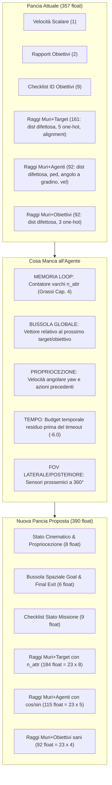
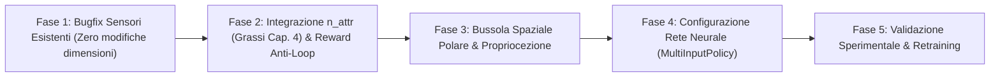

# Piano di Miglioramento: Spazio delle Osservazioni e Percezione dell'Agente (RL-Godot)

Documento operativo e strategico per potenziare le informazioni sensoriali e interne ("in pancia") all'agente pedonale, basato sull'audit di [`Confronto_Relazione_Grassi_vs_Codebase.pdf`](../docs/Confronto_Relazione_Grassi_vs_Codebase.pdf), della relazione originale ([`Relazione_stage_Grassi-36-57.pdf`](file:///home/gigi/Documenti/Relazione_stage_Grassi-36-57.pdf), Capitoli 3 e 4) e della codebase Godot 4.2 / Stable-Baselines3.

---

## 1. Diagnosi dello Stato Attuale & Quadro Comparativo

### 1.1 Sintesi Comparativa dei Modelli

| Dimensione | Grassi - Cap. 3 (Pianificazione) | Grassi - Cap. 4 (Esplorazione) | Codebase Attuale (Godot) | Stato & Diagnosi |
| :--- | :--- | :--- | :--- | :--- |
| **Float Totali** | **333 float** | **356 float** | **357 float** | Dimensione fissa, ma vettori concettualmente disallineati |
| **Normalizzazione Distanze** | $\frac{d}{43.0\text{ m}}$ (diagonale max $30\times 30$) | $\frac{d}{43.0\text{ m}}$ (diagonale max $30\times 30$) | $\frac{d}{10.0\text{ m}}$ (`RAY_LENGTH_OBS`) | **Critico**: satura a 10m; ambiguità numerica $0.0$ tra vuoto e impatto |
| **Stato Obiettivi Intrinseco** | 10 booleani (9 obj + 1 final) | 10 booleani (9 obj + 1 final) | 2 scalari norm + 9 slot checklist | Buona granularità logica, ma **nessuna informazione spaziale/direzionale** |
| **Percezione Varchi / Target** | 10 booleani raggiungibilità per raggio | Contatore attraversamenti $n_{\text{attr}}$ per raggio | *Direction Alignment* (dot product $[-1, 1]$) | Godot riconosce la direzione d'ingresso ma **non ha memoria dei loop ($n_{\text{attr}}$)** |
| **Dinamica Altri Pedoni** | Distanza, booleano, angolo relativo, velocità | Distanza, booleano, angolo relativo, velocità | Distanza, tipo, angolo relativo, velocità | **Grave bug matematico**: angolo con salto discontinuo $-1.0 \leftrightarrow +1.0$ a $0^\circ/360^\circ$ |
| **Propriocezione / Cinematica** | Solo velocità scalare | Solo velocità scalare | Solo `speed_norm` | Agente cieco su rotazione, velocità laterale, tempo residuo |
| **Bussola / Navigazione Globale** | Assente (guida tramite raggi varchi) | Assente (esplorazione autonoma) | Assente | Se l'obiettivo non è visibile nei raggi, l'agente vaga alla cieca |

---

## 2. I Tre Bug Matematici Scoperti nei Sensori Attuali

Durante il controllo puntuale del codice sorgente di [`RayCastSensor3D.gd`](../godot/objects/pedestrian/RayCastSensor3D.gd) sono emerse tre falle matematiche che corrompono il gradiente della rete neurale:

### Bug 1: Ambiguità Numerica Distanza Raggi (`_get_raycast_distance`)
* **File sorgente**: [`RayCastSensor3D.gd#L538-556`](../godot/objects/pedestrian/RayCastSensor3D.gd#L538-556)
* **Codice attuale**:
  ```gdscript
  func _get_raycast_distance(ray: RayCast3D) -> float:
      if !ray.is_colliding():
          return 0.0  # <-- PROBLEMA: Spazio aperto restituisce 0.0!
      var distance = origin.distance_to(collision_point)
      if distance > Constants.RAY_LENGTH_OBS:
          return 1.0
      return distance / Constants.RAY_LENGTH_OBS
  ```
* **Effetto nocivo**:
  - Quando il raggio non tocca alcun ostacolo (spazio completamente libero), restituisce `0.0`.
  - Quando il raggio urta un muro a $1\text{ cm}$ (collisione imminente e letale), restituisce $\frac{0.01}{10} = 0.001 \approx 0.0$.
  - La rete neurale riceve lo stesso identico valore numerico per "strada libera" e "muro in faccia".
* **Soluzione ingegneristica**:
  Adottare lo standard robotico/ML-Agents:
  - Spazio libero (nessuna collisione): `1.0` (oppure normalizzazione invertita dove `0.0` = lontano/nullo e `1.0` = impatto imminente: $1.0 - \frac{d}{d_{\max}}$).

---

### Bug 2: Discontinuità Trigonometrica nell'Angolo dei Pedoni (`calculate_agents_walls`)
* **File sorgente**: [`RayCastSensor3D.gd#L517-522`](../godot/objects/pedestrian/RayCastSensor3D.gd#L517-522)
* **Codice attuale**:
  ```gdscript
  var diffAng = clamp0360(
      clamp0360(rad_to_deg(collider.rotation.y)) - 
      clamp0360(rad_to_deg(rotation.y))
  )
  direction = clamp((diffAng / 180.0) - 1.0, -1.0, 1.0)
  ```
* **Effetto nocivo**:
  - Se due pedoni viaggiano quasi paralleli a $0.5^\circ$: `diffAng = 0.5` $\rightarrow$ `direction = -0.997`.
  - Se oscillano impercettibilmente a $359.5^\circ$: `diffAng = 359.5` $\rightarrow$ `direction = +0.997`.
  - Una variazione di solo $1^\circ$ attorno all'orientamento parallelo causa un salto discontinuo da $-1.0$ a $+1.0$. Inoltre, se i pedoni sono in nodi batch diversi, `rotation.y` locale differisce dal riferimento globale.
* **Soluzione ingegneristica**:
  Proiezione continua seno/coseno su coordinate globali:
  $$\Delta \theta = \text{wrap\_angle}(\text{global\_rot}_{\text{other}} - \text{global\_rot}_{\text{self}})$$
  $$\text{dir}_{\cos} = \cos(\Delta \theta), \quad \text{dir}_{\sin} = \sin(\Delta \theta)$$
  Se paralleli ($\Delta \theta = 0^\circ$): $\cos(0) = +1.0$. Se opposti frontali ($\Delta \theta = 180^\circ$): $\cos(\pi) = -1.0$. Continua e priva di singolarità.

---

### Bug 3: Falsa Direzione del Raggio nel Target Alignment (`get_side_from_normal`)
* **File sorgente**: [`RayCastSensor3D.gd#L418`](../godot/objects/pedestrian/RayCastSensor3D.gd#L418) e [`target.gd#L69`](../godot/objects/targets/target.gd#L69)
* **Codice attuale**:
  ```gdscript
  var ray_direction = -collision_normal.normalized()
  var dot = ray_direction.dot(target_forward_global)
  ```
* **Effetto nocivo**:
  - La normale di collisione di una superficie rettangolare non coincide con il vettore di incidenza del raggio se l'angolo non è a $90^\circ$.
  - Se il pedone guarda il fronte del target, la normale della faccia punta verso il pedone (+Z locale del target). Invertendola (`-collision_normal`), punta verso -Z, producendo un dot product negativo ($-1.0$), classificando paradossalmente l'approccio frontale come `"back"`.
* **Soluzione ingegneristica**:
  Calcolare il vero vettore del raggio dal punto d'origine al punto d'impatto:
  $$\vec{v}_{\text{ray}} = \frac{\vec{p}_{\text{collision}} - \vec{p}_{\text{ray\_origin}}}{\|\vec{p}_{\text{collision}} - \vec{p}_{\text{ray\_origin}}\|}$$
  Oppure usare direttamente il vettore velocità globale del pedone proiettato sulla normale del varco.

---

## 3. Cosa Manca nella "Pancia" dell'Agente: Analisi dei Deficit Informativi



### Deficit 1: Assenza del Contatore di Visita Varchi ($n_{\text{attr}}$ di Grassi Cap. 4)
Nel Capitolo 4 di Grassi, l'agente non cade in loop infiniti nei labirinti perché ogni raggio che colpisce un target intermedio riporta quante volte quel varco è stato attraversato. In Godot, l'agente vede solo la forma geometrica della porta e la checklist, ma **non sa se quel varco lo ha già oltrepassato 0, 1 o 10 volte**. Quando si trova in `Blind2` o `Labyrinth`, l'assenza di $n_{\text{attr}}$ favorisce traiettorie oscillanti a pendolo.

### Deficit 2: Cecità Spaziale Globale (Mancanza di Bussola Polare)
I raggi vedono fino a $10\text{ m}$ in linea retta entro un cono frontale di $180^\circ$. Se un obiettivo o il target finale si trova dietro un angolo a $12\text{ m}$, l'agente non ha alcun segnale che indichi dove dirigersi. L'introduzione di una **bussola polare relativa** $(\frac{d}{d_{\max}}, \cos\theta_{\text{rel}}, \sin\theta_{\text{rel}})$ fornisce un gradiente direzionale continuo anche attraverso pareti cieche.

### Deficit 3: Povertà Cinematica (Nessuna Consapevolezza di Rotazione e Azione Passata)
L'agente produce azioni continue `rotate` $[-1, 1]$ e `move` $[-1, 1]$. Tuttavia riceve in ingresso solo `speed_norm`. Non conosce:
1. La velocità angolare istantanea (rischio di oscillazioni spasmodiche).
2. L'azione applicata allo step precedente ($a_{t-1}$).
3. La velocità laterale/deriva (essenziale per la fisica di collisione in folla).

### Deficit 4: Mancanza del Budget Temporale Residuo
L'episodio si chiude con penalità pesante ($-6.0$) al raggiungimento di `reset_after` step. L'agente non riceve la frazione di tempo rimasta ($\frac{\text{reset\_after} - n_{\text{steps}}}{\text{reset\_after}}$). Senza questa informazione, la policy non può modulare l'aggressività: a inizio episodio conviene esplorare; a 20 step dal timeout conviene sprintare verso l'uscita.

---

## 4. Architettura dello Spazio delle Osservazioni Proposto

Progettazione di una nuova pancia sensoriale a **390 float** (o compatibile 357 float se si preferisce preservare il layout base), standardizzata nell'intervallo compatto $[-1.0, +1.0]$:

### 4.1 Tabella Dettagliata delle Variabili (Totale: 390 float)

| Canale | Variabili | Formato / Normalizzazione | Dimensione |
| :--- | :--- | :--- | :---: |
| **1. Cinematica & Propriocezione** | `speed_norm` | Avanzamento normalizzato in $[0, 1]$ | 1 |
| | `angular_velocity_norm` | Velocità di rotazione normalizzata in $[-1, 1]$ | 1 |
| | `prev_action_move` | Azione movimento $t-1$ in $[-1, 1]$ | 1 |
| | `prev_action_rotate` | Azione rotazione $t-1$ in $[-1, 1]$ | 1 |
| | `time_remaining_norm` | $\frac{\text{reset\_after} - n_{\text{steps}}}{\text{reset\_after}} \in [0, 1]$ | 1 |
| | `objectives_collected_norm` | $\frac{N_{\text{racc}}}{N_{\text{tot}}} \in [0, 1]$ | 1 |
| | `objectives_remaining_norm` | $\frac{N_{\text{rim}}}{N_{\text{tot}}} \in [0, 1]$ | 1 |
| | `all_objectives_flag` | $1.0$ se raccolti tutti, $-1.0$ se ne mancano | 1 |
| **2. Bussola Spaziale Globale (Polar Beacon)** | **Prossimo Obiettivo Attivo**: Distanza | $\min\left(\frac{d_{\text{target}}}{43.0}, 1.0\right) \in [0, 1]$ | 1 |
| | **Prossimo Obiettivo Attivo**: Direzione | $\cos(\theta_{\text{target}}), \sin(\theta_{\text{target}}) \in [-1, 1]$ | 2 |
| | **Target Finale**: Distanza | $\min\left(\frac{d_{\text{final}}}{43.0}, 1.0\right) \in [0, 1]$ | 1 |
| | **Target Finale**: Direzione | $\cos(\theta_{\text{final}}), \sin(\theta_{\text{final}}) \in [-1, 1]$ | 2 |
| **3. Checklist Missione** | Slot ID Obiettivi (Curriculum) | 8 slot: $-1$ assente, $0$ da prendere, $+1$ preso | 8 |
| | Final Target Reached Flag | $1.0$ se raggiunto, $0.0$ altrimenti | 1 |
| **4. Raggi Muri & Target (23 raggi $\times$ 8 float)** | Distanza corretta | $1.0 - \frac{d}{10.0}$ se collisione, $0.0$ se libero | $23 \times 1 = 23$ |
| | One-Hot Encoding Tipo Target | 5 canali (muro, int_val, int_inval, fin_val, fin_inval) | $23 \times 5 = 115$ |
| | Direction Alignment | Dot product raggio-normale in $[-1, 1]$ | $23 \times 1 = 23$ |
| | **Contatore Loop $n_{\text{attr}}$ (Grassi Cap. 4)** | $\min\left(\frac{n_{\text{crossings}}}{5.0}, 1.0\right)$ se varco, $-1.0$ altrimenti | $23 \times 1 = 23$ |
| **5. Raggi Muri & Agenti (23 raggi $\times$ 5 float)** | Distanza corretta | $1.0 - \frac{d}{10.0}$ se collisione, $0.0$ se libero | $23 \times 1 = 23$ |
| | Tipo Ostacolo | $0$ libero/muro, $1$ pedone | $23 \times 1 = 23$ |
| | Heading Relativo Trigonometrico | $\cos(\Delta \theta)$ e $\sin(\Delta \theta) \in [-1, 1]$ | $23 \times 2 = 46$ |
| | Velocità Altro Pedone | Scalare normalizzato $[0, 1]$ | $23 \times 1 = 23$ |
| **6. Raggi Muri & Obiettivi (23 raggi $\times$ 4 float)** | Distanza corretta | $1.0 - \frac{d}{10.0}$ se collisione, $0.0$ se libero | $23 \times 1 = 23$ |
| | One-Hot Encoding Obiettivo | 3 canali (muro, obiettivo nuovo, obiettivo già preso) | $23 \times 3 = 69$ |
| **TOTALE OSSERVAZIONI** | | | **390 float** |

*(Nota di flessibilità: se si vuole mantenere la dimensione invariata a 357 float durante i primi test di regressione, è possibile implementare l'Opzione Conservativa descritta nella Sezione 5.2).*

---

## 5. Piano Operativo di Intervento (Step-by-Step)



### Fase 1: Correzione dei Bug Matematici a Dimensione Invariata (357 float)
1. **Normalizzazione Distanze in [`RayCastSensor3D.gd`](../godot/objects/pedestrian/RayCastSensor3D.gd)**:
   - Riscrivere `_get_raycast_distance`:
     ```gdscript
     func _get_raycast_distance(ray: RayCast3D) -> float:
         if not ray.is_colliding():
             return 1.0  # Spazio libero = 1.0 (lontano)
         var dist = ray.global_position.distance_to(ray.get_collision_point())
         return clampf(dist / Constants.RAY_LENGTH_OBS, 0.0, 1.0)
     ```
2. **Normalizzazione Angolo Pedoni in [`RayCastSensor3D.gd`](../godot/objects/pedestrian/RayCastSensor3D.gd)**:
   - Eliminare `diffAng / 180 - 1`.
   - Utilizzare il coseno della differenza degli angoli globali di rotazione:
     ```gdscript
     var self_rot = pedestrian.global_rotation.y
     var other_rot = collider.global_rotation.y
     var diff = other_rot - self_rot
     direction = cos(diff)  # +1.0 = stessa direzione, -1.0 = frontale opposto
     ```
3. **Calcolo Geometrico di Attraversamento in [`pedestrian.gd`](../godot/objects/pedestrian/pedestrian.gd)**:
   - Sostituire `viewed_side` basato sui raggi intermittenti con il vettore velocità effettivo registrato in `_on_target_entered`:
     ```gdscript
     var crossing_velocity = velocity.normalized()
     var side = area.get_side_from_vector(crossing_velocity)
     ```

### Fase 2: Integrazione del Contatore Varchi ($n_{\text{attr}}$ Grassi Cap. 4)
1. **Tracciamento Passaggi nel Pedone**:
   - In [`pedestrian.gd`](../godot/objects/pedestrian/pedestrian.gd), istanziare un dizionario `target_crossing_counts: Dictionary = {}`.
   - All'attraversamento di un target:
     ```gdscript
     target_crossing_counts[area] = target_crossing_counts.get(area, 0) + 1
     var nattr = target_crossing_counts[area]
     # Penalità Grassi Cap. 4:
     if nattr > 1:
         tot_reward -= 0.03 * nattr
     ```
2. **Iniezione del Valore nei Raggi Muri+Target**:
   - In [`RayCastSensor3D.gd`](../godot/objects/pedestrian/RayCastSensor3D.gd): se il raggio colpisce un target, calcolare:
     ```gdscript
     var crossings = pedestrian.target_crossing_counts.get(collider, 0)
     var nattr_norm = clampf(float(crossings) / 5.0, 0.0, 1.0)
     ```
   - Restituire `nattr_norm` nel canale dedicato (oppure rimpiazzare l'alignment se si vuole preservare 357 float).

### Fase 3: Bussola Polare Spaziale & Cinematica Propriospettiva
1. **Calcolo Coordinate Polari Relative in [`pedestrian.gd`](../godot/objects/pedestrian/pedestrian.gd)**:
   - Funzione helper per calcolare distanza e angolo relativo verso una posizione 3D globale:
     ```gdscript
     func get_relative_polar_to(target_pos: Vector3) -> Dictionary:
         var delta = target_pos - global_position
         var dist = delta.length()
         var local_dir = transform.basis.inverse() * delta.normalized()
         var angle = atan2(local_dir.x, local_dir.z)
         return {
             "dist_norm": clampf(dist / 43.0, 0.0, 1.0),
             "cos_angle": cos(angle),
             "sin_angle": sin(angle)
         }
     ```
   - Iniettare le coordinate polari verso il prossimo obiettivo (il più vicino non ancora raccolto) e verso il target finale.
2. **Aggiunta del Budget Temporale e Azioni Pregresse**:
   - Passare in `AIController3D.gd` il tempo residuo normalizzato e le ultime azioni registrate in `set_action`.

### Fase 4: Aggiornamento della Pipeline Python e Configurazione Rete
1. **Configurazione Dimensione Vettore in [`AIController3D.gd`](../godot/objects/pedestrian/AIController3D.gd)**:
   - Aggiornare l'asserzione di sicurezza con la nuova dimensione:
     ```gdscript
     assert(obs.size() == NEW_OBS_SIZE, "Errore dimensione obs: attesi %d, ottenuti %d" % [NEW_OBS_SIZE, obs.size()])
     ```
2. **Adattamento del Modello in [`scripts/configs/base_config.yaml`](../scripts/configs/base_config.yaml)**:
   - Aumentare la capacità della rete di policy per gestire la maggiore ricchezza informativa:
     ```yaml
     policy_kwargs:
       net_arch:
         pi: [256, 256, 128]
         vf: [256, 256, 128]
       activation_fn: "torch.nn.Tanh"
     ```

---

## 6. Due Strategie di Rilascio: Conservativa vs Integrale

Per garantire continuità e mitigare il rischio di regressione, sono definite due strade:

### Opzione A (Conservativa - Dimensione Invariata: 357 Float)
* **Obiettivo**: Applicare i fix immediati senza alterare le forme dei tensori né invalidare gli script di test esistenti.
* **Cosa cambia nei 357 float**:
  1. Fix distanza `1.0` (libero) anziché `0.0`.
  2. Fix direzione pedoni con $\cos(\Delta \theta)$ continuo.
  3. Sostituzione del canale 7 dei raggi target: usare $n_{\text{attr}}$ (Grassi Cap. 4) invece dell'instabile `direction_alignment`.
  4. Fix attraversamento geometrico basato su velocità in `_on_target_entered`.
* **Vantaggi**: Nessun impatto su ONNX exporter, curriculum o file batch; risolve subito i fallimenti nei labirinti.

### Opzione B (Integrale - Architettura Potenziata: 390 Float)
* **Obiettivo**: Fornire la massima intelligenza percettiva all'agente pedonale.
* **Cosa include**:
  1. Tutti i fix dell'Opzione A.
  2. Bussola Polare Globale per Obiettivi e Uscita Finale (+6 float).
  3. Propriocezione completa: accelerazione angolare, budget temporale, azioni precedenti (+5 float).
  4. Mantenimento sia di `direction_alignment` sia di $n_{\text{attr}}$ sui target (+23 float).
  5. Seno e coseno separati per i pedoni vicini (+23 float).
* **Vantaggi**: Azzera la cecità oltre i 10 metri, stabilizza il controllo dello sterzo ed elimina completamente i loop di stallo in `Blind2` e `Labyrinth3`.

---

## 7. Metriche di Verifica e Protocollo di Validazione

1. **Test di Validazione Percettiva Unitaria**:
   - Eseguire Godot con `SHOW_RAYS = true` e verificare nella console di debug che:
     - In corridoio vuoto, la distanza dei raggi sia esattamente `1.0`.
     - Ruotando attorno a un altro pedone, `direction` vari con continuità sinusoidale tra $-1.0$ e $+1.0$.
     - Attraversando lo stesso varco più volte, il contatore $n_{\text{attr}}$ si incrementi linearmente.
2. **Benchmark di Addestramento sui Livelli Critici**:
   - Eseguire una run di prova isolata su `Blind2` e `Labyrinth` confrontando il tempo di convergenza rispetto alle run storiche (`output_bene_maleblind2_da_fixare`).
   - Monitorare l'indicatore `rollout/ep_rew_mean` in TensorBoard: l'assenza di oscillazioni a vuoto deve accelerare il superamento della soglia del callback `EndTrainingCombinedCallback`.
3. **Analisi Quantitativa PedPy**:
   - Esecuzione sui livelli di test (`DoubleDoor`, `Bottleneck`, `Funnel`).
   - Verifica della fluidità di marcia (riduzione delle frenate a scatti) e coerenza con le curve empiriche di Weidmann.
